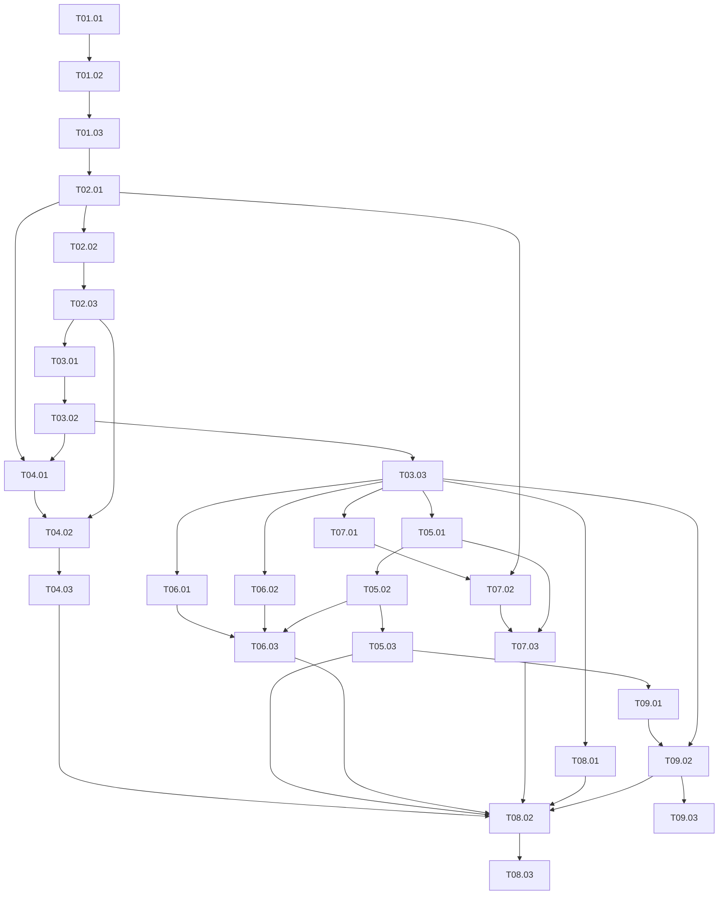

# 已归档：v0.4实施计划（范围历史，不再作为排期依据）

# 个人财务助手实施计划 v0.4

> 版本：v0.4，2026-10-29；保留既有任务编号，补齐完整应用与借鉴改造。  
> 主规格：[个人财务助手规格](../../specs/personal-finance-assistant.md)  
> 科目依据：[一期科目目录](../../specs/chart-of-accounts.md)  
> 验收依据：[验收案例](../../specs/acceptance-cases.md)（AC-01—AC-57）  
> 借鉴依据：[参考设计与改造清单](../../specs/reference-design-shiqingqi.md)（B01—B15、N01—N08）  
> 状态：已有本地加工与工作簿原型，并已按 v0.3 重算当前已捕获数据及导入收入性质确认；完整性缺口仍保留。本计划用于独立应用和本地 MCP 的后续实施，两者尚未完成。

## 1. 交付目标与范围调整

交付一个单用户、本地运行的个人财务应用。以 SQLite 和轻量 ETL 保存证据、当前交易、修改记录及派生分录；用户在本机界面完成导入、修改、对账、报表和计划管理。Codex 通过本地 MCP 领取任务、提交结构化建议，AI 是否在线不影响规则处理和已有账本、报表的使用。

一期采用有限业务类型的简化复式记账。资产范围为现金账户、投资、公积金；确有依据时按需启用押金和其他应收。工作垫付全部留在费用，报销到账记 4005 其他业务收入／报销回款，待收只备忘，1004 保留但本模式停用；家庭赞助记 4005 的独立子类型。负债包括信用卡等结算负债和有证据的借款、房贷本金。房产、汽车和设备不建资产台账；不需要提交房产资料才能完成一期。具体科目名称、类别和启用条件只以[一期科目目录](../../specs/chart-of-accounts.md)为准，维持 37 个条目，本计划不复制第二份科目清单。

基础三表从首阶段开始交付，后续业务逐步补充相应项目：

- **账户资产与负债表**：列出纳入范围的已知账户资产、负债和范围净额；范围净额不称为完整家庭净资产，未知余额和缺口明确列示。
- **收支结余表**：按确认期间显示总额收入、费用及结余；含工作垫付费用、报销回款与家庭赞助收入，明确为个人管理口径，不能称纯个人消费或企业净利润。投资已实现和未实现收益区分展示，缺少成本时保留未知。
- **现金流与未来资金安排表**：实际收付与预测分列；实际按消费及工作垫付付款、报销回款、家庭赞助、信用还款、其他往来、投资、借款、本金／利息、公积金等业务类型显示，内部现金互转剔除，未明类型的现金变动单列。报销保留先垫后收日期，预算月均估计不当固定到账。

与旧版相比，本版的范围和政策调整如下：

| 旧版要求 | v0.3 处理 |
| --- | --- |
| 工作垫付记应收、不计费用，报销回款核销应收 | 垫付保留费用，回款记 4005／报销回款；待收只备忘，不能同时增加同笔应收资产。旧有费用剔除和应收效果按版本迁移，不重复恢复。 |
| 实际报销处理与预算基线混用 | 实际总额保留，预算采用同一完整窗口的 R 同时抵收入和费用，按 R/m 平滑，汇总调整行不摊类别；冻结已采用估计，修订另存。 |
| 人工纠错必须先冲销再更正 | 用户直接修改当前交易；应用保存前后值日志，并原子替换或重算受影响的派生分录。 |
| 月结、关闭期间及受控重开 | 不设月结锁和重开流程；历史编辑直接更新当前有效结果，旧报告标明所依据的数据版本及是否已过期。 |
| 资产化门槛、设备折旧、预付款摊销和完整家庭财富核算 | 普通耐用品、已购买订阅当次记消费；预付款摊销引擎延期，房产／汽车／设备资产台账不纳入一期。 |
| 完整资产和历史资料齐备后才交付三表 | 首阶段按已知范围交付基础三表；工资、债务和投资模块分别补充，缺口保留。 |
| 标准企业经营／投资／筹资三类及间接法现金流调节 | 一期按实际收付的业务类型展示；不要求间接法，也不以逐笔还款追溯消费用途作为现金表可用前提。 |
| 补齐 2026 年前全部投资交易才可使用投资模块 | 接受有证据的期初／持仓快照；显示已知份额、金额和成本缺口，不能据此伪造历史成本或收益。 |

去重、业务关联、精确金额、借贷平衡、原子提交、幂等、版本冲突检查及可验证的备份恢复继续保留。

v0.4 新增的产品和工程方案为：Python／FastAPI 单一核心服务、React／TypeScript／Vite 前端、SQLite 本地存储、调用核心服务的 MCP 适配层；消费发生、生活预算占用与现金收付独立计量。上表历史政策继续有效，37 个科目不变。上游只提供可验证的模式参考，实际借用代码前核对 MIT 许可并保留要求的声明。

## 2. 各阶段共同遵守的约束

1. **证据与当前状态分离**：源文件和源记录不可覆盖。业务交易具有当前版本；修改日志保存操作者、时间、理由及前后值。派生分录带交易和规则版本，只汇总当前有效分录，不把已被替代版本再加一次。退款属于新的业务交易，不以编辑原消费模拟。
2. **规则先行，未知按性质处理**：可确定为消费且账户、金额等必需信息齐全时，分类不明也可记为“未分类支出”，进入消费总额和总预算；之后补分类不增加第二笔消费。性质不明的资金流保留证据和待确认状态，不借“未分类支出”伪造费用，也不为平账凭空创建应收资产。已有可靠账户收付证据的金额可在现金表的待确认区单列，并明确其与已入账金额的区别。
3. **共用业务命令**：界面、ETL 和 MCP 使用同一套应用校验与事务。每次写入检查金额、币种、证据、业务版本和适用规则版本；重复请求只产生一次效果，相同幂等键不同内容返回冲突。规则处理不依赖 AI 连接。
4. **关联有证据、分配有上限**：重复、内部互转、信用卡还款、退款、报销事项与回款分别建模；支持部分和一对多关联。日期金额相近只能形成候选。重复交易可标记合并，全部来源保留；退款、报销回款和还款不能因是收款或负数就自动判定。报销关联更新备忘，不在费用保留时增加同笔应收资产。
5. **现金口径可独立使用**：信用还款按实际还款业务展示，不重复计消费；有证据时再补消费关联。未知本金不得从月供或其他金额反推；已知还款总额但本息未明时展示还款现金事实及拆分缺口。内部现金互转不膨胀收付总额，已确认属于内部互转但仅有一端时保留缺端提示。
6. **范围与未知可见**：期初、账户覆盖、币种、估值时点、工资净额／明细口径分别标注。没有证据不填零、不补造差额、不默认不同币种可加总。余额快照是余额证据，不自动证明期间流水完整。
7. **计划不改实际**：收入／消费预算、投资投入计划、现金安排分别保存；同一计划的引用关系不能导致重复资金需求。原始预算保留，采用时冻结报销参考窗口、m、R、月均估计和其他假设，修订预算和滚动预测另存版本。预实保留原始与标准化口径；未分类消费计入总预算，资料缺口、回款时点和估计变化不能被解释为消费节约。
8. **基础运行独立于会话**：本地界面可导入、人工修改、对账、查看报表和维护计划。Codex 不在线时 AI 待办保留，其他功能继续运行；不要求用户维持长期聊天、不额外调用云模型 API、不默认建立定时任务。
9. **验证边界真实**：开发和自动化验收用合成样本；真实导出格式、历史余额及平台兼容性在取得相应样本后另验。手工／文件导入必须形成闭环，外部金融接口不是一期交付前置条件。
10. **报销标准化不改变现金事实**：参考窗口优先完整年度或滚动 12 个月，收入、费用、报销累计 R 同窗；完整零回款月计入 m，缺月／部分月不当零。两侧同时抵 R，结余不变；以 R/m 平滑，不因集中回款而近期加权。先在汇总基线抵报销，再对标准化可变消费应用缩减倍率，不伪造逐笔归属或均摊类别。家庭赞助不抵费用、未来默认不依赖；未来工资已排除报销，不再扣一次。实际与预测保留收付日期、先垫后收风险、跨年待收和未知尾款，不能用 R/m 代替固定月度到账。

## 3. 阶段与可拿取任务

以下 9 个阶段共 27 项任务。每项交付可从界面或正式本地接口验证的业务行为，不以“数据库、接口或页面已完成”代替业务验收。表中的任务依赖是唯一执行前置关系；阶段编号表示阅读和集成顺序，不要求同一阶段全部完成后才能启动后续独立任务。不在当前文档工作中创建 Issue、启动开发或处理真实资料。

### 阶段 01：导入一份账单，即可查看基础三表

**可演示结果**：导入合成账单后，规则把明确消费记入账本；分类未知的消费仍计入总支出，性质不明的记录留待确认，三表显示当前已知范围。

| 任务 | 前置依赖 | 交付 | 可验证验收 |
| --- | --- | --- | --- |
| T01.01 受控导入与证据查看 | 无 | Python／FastAPI 核心服务、SQLite 迁移与精确金额合同；标准最小导入格式、批次、不可覆盖证据、字段检查和 React／TypeScript 结果页 | 样本包含有效行、坏行及重复上传；有效行可定位源证据，坏行保留原因；重传不会新增同一源记录的业务效果。未知格式不猜字段入账。 |
| T01.02 规则处理与最小自动入账 | T01.01 | 现金／信用账户、有限业务类型、可启用的导入规则、结构化候选和共用原子入账命令；接入科目目录 | 明确消费生成平衡分录；明确消费但细分类不明时记未分类支出；性质不明的转出保存待确认，不伪造成费用或应收。重复请求、过期版本及中断均不能造成双记或半笔账。 |
| T01.03 账本与基础三表 | T01.02 | 可筛选交易、源证据下钻、三表的已知项目与覆盖说明、当前数据版本、重启恢复 | 合成消费金额可手算核对；账户表说明范围净额和未知期初；收支表含未分类消费；现金表实际与未来安排分列，待确认现金金额另示，尚未录入的预测标为未设置。缺工资单、投资历史或房产资料不阻止打开三表；重启后结果一致。 |

**阶段门槛**：通过“导入 → 规则 → 校验 → 账本 → 三表 → 源证据”闭环。此时交付的是已知范围的基础报表，不声称所有账户已核对。

### 阶段 02：直接修改交易，并处理重复与资金关系

**可演示结果**：用户修改一笔消费或合并重复记录后，当前账本和报表立即反映结果；退款、信用还款和报销回款保持独立业务含义。

| 任务 | 前置依赖 | 交付 | 可验证验收 |
| --- | --- | --- | --- |
| T02.01 当前交易编辑与派生重算 | T01.03 | 类别、金额、账户、消费／结算日期、标签及业务类型的直接修改与跨重启撤销；前后值日志、版本检查、受影响关系校验、分录替换和报告版本更新 | 改类别不新增消费；改金额后分录、汇总同步变化；消费日修改不自动移动还款日。撤销以新版本恢复前值并重新校验，后续关联不允许时解释冲突；旧界面提交被拒绝，重试不重复修改。编辑导致已分配金额超限时整项拒绝并给出关联提示，不能留下半改状态。源证据不变，用户无需手工冲销；后续投资计算复用同一修订合同。 |
| T02.02 多来源适配与重复合并 | T02.01 | 银行、信用卡和支付渠道的样本适配器，文件／行／跨来源去重候选及合并入口 | 相同文件改名、重叠导出、同消费跨源记录只产生一次消费；合并已入账重复交易后替换其派生结果，报表扣除多计部分且保留全部来源及合并日志。合法同日同额两笔交易不机械合并；真实格式兼容性保留待样本验证。 |
| T02.03 互转、还款、退款与报销关联 | T02.02 | 关系类型及部分／一对多分配；报销事项、分次回款、已知待收与未知尾款备忘，4005 子类型 | 内部现金互转不算收入费用，也不放大现金收付；信用消费记费用及负债，还款只减少负债，现金表无需原用途即可显示信用还款。真实退款为新交易，在退款确认期冲减对应费用并保留原消费；累计关联不得超额。工作垫付全留费用，报销到账记 4005／报销回款，家庭赞助记独立子类型；待收只备忘，1004 本模式停用，不能费用和同笔应收同时累计。拒报不重复记费用，缺证据时保留待确认。 |

### 阶段 03：核对余额、解释缺口，并独立日常使用

**可演示结果**：用户录入或导入带日期的账户余额，看到流水和余额差异，直接修正已找到的漏项或错误，并在关闭 Codex 后继续工作。

| 任务 | 前置依赖 | 交付 | 可验证验收 |
| --- | --- | --- | --- |
| T03.01 期初、余额快照与分层对账 | T02.03 | 按账户、币种、日期、余额定义保存期初和外部快照；带证据及生效日的范围加入／退出；账面余额、流水覆盖和差异计算 | 同范围完整样本满足期初加期间变动等于期末；未知期初不显示“对账通过”。银行现金余额、信用卡账单应还、全部未偿金额使用各自定义；有快照但缺流水时同时显示已知余额及缺口，不自动补差额。范围变更不产生虚构收入或收付，现金比较不混用两种账户范围，系统范围科目不能用于对账平差。 |
| T03.02 疑点工作台与差异修复 | T03.01 | 待确认资金流、重复候选、未匹配关系和余额差异的统一入口；证据对照、补录／修改／延后与重算 | 疑点区分影响金额、分类、关系和完整性，多原因按业务 ID 去重，延后不当确认；找到漏项后补录可实际缩小差异，仅知道差额时不得生成其他收入或费用平账。处理重走同一校验，未分类消费已计入消费总额的事实不丢失。 |
| T03.03 覆盖看板、同源导出与独立运行 | T03.02 | 来源／账户／期间覆盖看板，日常操作入口，三表及明细的 Excel／CSV 同源导出，启动和维护说明 | 无 Codex 会话时完成导入、编辑、对账和报表查看；重启可恢复。页面与导出金额、范围、币种、截止时间、数据版本和缺口一致；未知、未收到、已解析、已入账、已对账可区分，未接入来源不显示已同步。 |

### 阶段 04：Codex 通过本地 MCP 协助处理疑点

**可演示结果**：新 Codex 会话领取持久待办并提交建议；应用校验后应用明确结果，冲突留待处理，AI 中断不影响账本。

| 任务 | 前置依赖 | 交付 | 可验证验收 |
| --- | --- | --- | --- |
| T04.01 持久任务与最小 MCP 上下文 | T02.01、T03.02 | stdio MCP 薄适配层调用本地核心服务，不直接写 SQLite；待办查询、限时领取、必要证据／规则／版本读取、操作结果查询；query_transactions 和 get_report 只读工具 | 关闭旧会话后新会话能继续；领取过期可回收且旧令牌不能提交。只读查询返回有限明细及已有报表的范围、版本和缺口；不能任意执行 SQL、绕过应用写库或发起外部资金交易。 |
| T04.02 结构化建议与统一原子提交 | T04.01、T02.03 | 候选协议、证据要求、租约／事件／规则版本校验、幂等提交和结构化错误；submit_analysis 分析保存工具 | 明确建议可通过共用业务命令应用；证据不足不伪造业务性质。人工修改后旧建议被拒绝；同键同负载返回原结果，同键不同负载报冲突。并发、超时重试和写入中断不重复入账；提交结果与任务状态一致。分析保存只接受存在的快照／证据引用并保留事实版本，不能修改实际、预算或规则。 |
| T04.03 规则治理与 Codex 端到端验证 | T04.02 | 新规则建议、人工启用、规则版本及影响预览，真实 Codex 连接演示，等待 AI 状态说明 | AI 不静默改写已确认规则、人工交易或已采用预算；新规则的历史影响可预览，再经明确操作更新当前交易并留日志。用合成样本完成真实 Codex 演示；连接暂不可用时可验协议和本地流程，但真实连接仍标待验。断开后规则、人工操作和报表照常使用；AI 失败不按金额符号强制入账，中文短商户保留，单笔编辑不隐含新增长期规则。 |

### 阶段 05：预算、预实分析与未来现金安排

**可演示结果**：用户设置收入／消费预算和未来收付款计划，实际消费更新后得到可复核的差异和资金缺口，不因未分类或资料缺失出现虚假的节约。

| 任务 | 前置依赖 | 交付 | 可验证验收 |
| --- | --- | --- | --- |
| T05.01 收入与消费预算版本 | T03.03 | 生活用途 N×12 预算、三种 basis 与行执行规则、原始及标准化基线、独立报销汇总调整行、采用时冻结的估计、修订版及选定比较版本 | 同一完整窗口的收入 I、费用 E 同时减报销累计 R，结余不变，按 R/m 月均；优先完整年度或滚动 12 个月，完整零回款月计入 m，缺月／部分月不当零，集中回款不近期加权。抵减不摊类别或改逐笔实际；先抵报销再缩减可变消费，划分不足标假设。家庭赞助不抵费用且未来默认不依赖，未来已排除报销的工资不再扣。采用时冻结窗口、估计和倍率，后续修订另存，原预算不覆盖。未分类支出计总额；生活预算按消费、特定履约或年度额度归集，原购置与其按期付款互斥，投资投入计划单列。消费口径不以生活预算替代。 |
| T05.02 现金安排与情景预测 | T05.01 | 全年期次、唯一键、部分履约与未履约替代；工资、信用还款、借款本息、报销回款、投资投入／回收计划；年度额度月分配与日期未知、实际／预测分列、资金事项及账单分配去重 | 计划不生成实际分录；年度月分配尾差守恒，到期不自动伪造付款；同一事项从预算、投资计划和还款安排引用时只计一次现金需求，信用卡账单已含的分期不额外加总；实际发生后匹配替代相应预测，不能继续双计。报销实际保留先垫后收日期，未来按有依据日期安排，不把 R/m 当固定到账；跨年待收、未知尾款、回款延迟及周转缺口明确显示，家庭赞助默认不入基准。未知起始现金、未知本息或来源缺口明确影响预测可信范围，不输出伪精确可用余额。 |
| T05.03 预实差异、提醒与解释入口 | T05.02 | 本月剩余额度、预计留存、目标缺口及三种 basis 的下钻；原始与标准化实际并列、所选预算版本、收入／费用偏差、报销调整及估计变化解释、交易下钻和事实型预警；可供 MCP 读取的快照及分析记录 | 按主规格第 12.6 节可手算核对额度及留存公式，目标上调不自动修改方案，银行余额与额度分列；同口径比较，费用偏差为实际减预算，收入同式但含义不同；零／未设预算不显示无意义比例，多标签不重复汇总。冻结预算估计不随回款覆盖，新增估计另存版本；分开解释费用变化与回款时点／估计变化，不把集中报销或少回款称为消费节约／超支。真实退款按确认期处理，原消费归因视图另标。未分类、待确认和资料缺口可见；计算和提醒无需 AI。分析引用事实、期间、口径和假设，基础数据更新后标过期；MCP 接入由 T04.02 和最终集成验证，接受建议只更新相应计划。 |

### 阶段 06：工资、公积金和债务信息接入现有报表

**可演示结果**：只有工资到账和月供总额时可先使用已知信息；补充工资单、公积金及本息资料后，当前结果得到更新，收入和现金不重复计入。

| 任务 | 前置依赖 | 交付 | 可验证验收 |
| --- | --- | --- | --- |
| T06.01 工资口径与公积金 | T03.03 | 工资到账／工资单关联、明细拆分与净额口径、公积金余额及缴存／提取记录 | 无工资单时允许按银行净到账确认并标明净额口径；有明细再按证据更新同一工资事实，不能叠加第二笔收入。 可用资金继续取净到账，已扣税社保及公积金凭工资关联排除于生活预算占用，补单前后生活留存不变；独立缴费不能按科目一律排除。公积金个人／单位缴存和工资扣项按规格关联，提取不误计收入；缺明细只显示已知事实及缺口，不反推税前金额。 |
| T06.02 房贷及其他债务本息与计划 | T03.03 | 已知贷款本金余额、实际本息拆分、原购买全额费用、信用／融资分期和未来还款计划；资料时点及来源 | 有证据的本金减少负债，利息进入消费费用；未来利息不提前计当前负债或费用，原购置不改成首期金额；还款计划不当作实际发生。未知本金不从月供、利率或房产价值推算；仅知总还款时现金表可显示已知偿债收付，本息及负债变化保持待确认。不建房产资产也可记录房贷。 |
| T06.03 月度收入与偿债总览 | T06.01、T06.02、T05.02 | 工资、公积金、债务在三表、预算和未来资金安排中的联动视图及修订传播 | 工资补资料、本息改正和公积金到账后，受影响报表及预测用新版本计算，旧结果可识别为过期。现金表按实际收付业务类型显示，本金不进入费用口径预算，但按期付款的生活预算包含本金与利息合计一次；利息按确认期进入费用表；公积金到现金账户的已确认提取按公积金业务显示，不作为新增收入。普通耐用品及已购买订阅仍当次计消费，无折旧／摊销前置条件。 |

### 阶段 07：投资手工／文件闭环与收益展示

**可演示结果**：不接外部行情接口也能录入交易或持仓快照，看到有证据的份额、价值、成本和收益；缺成本的持仓仍可展示已知部分。

| 任务 | 前置依赖 | 交付 | 可验证验收 |
| --- | --- | --- | --- |
| T07.01 投资交易与持仓快照 | T03.03 | 手工录入和文件导入申购、赎回、费用、分红、红利再投、持仓快照及带日期的净值；投资账户资金关联 | 有完整样本时可复核份额和资金变动；仅有快照时显示已知份额／市值、时点、成本缺口及交易覆盖。无需补齐 2026 年前历史；未知成本不填零，快照不冒充历史交易。银行与已纳入现金范围的投资资金账户互转剔除，申购赎回按投资收付显示。 |
| T07.02 移动加权成本与收益重算 | T07.01、T02.01 | 按账户／产品的移动加权成本、已实现与未实现收益、正式估值记录、当前报告接入及历史编辑传播 | 完整 fixture 的申购、部分赎回、费用和分红可手算复核；实现收益与已转出的浮盈不双计。历史交易或成本更正后按时间重算后续数量、成本、处置收益及估值派生结果，保留修改日志和版本；重算完成前不能把旧收益标成最新。成本不足时相关收益未知，已知收付款仍可显示，不能为了生成平衡报表捏造成本。 |
| T07.03 投资计划与持仓对照 | T07.02、T05.01 | 投资投入计划、目标、实际成交关联、收益与现金预算对照；手工估值更新及陈旧提示 | 计划不变实际份额和现金；成交关联后不重复预测投入。已实现收益与未实现估值分别展示，未实现估值不进入收入预算执行率。无外部数据服务仍能完成完整样本闭环；只有快照的样本显示可知与不可知范围，不假装收益完整。 |

公开净值或账户 MCP 可在以后作为独立增强接入；能力、授权与使用条件未验证前不纳入完成门槛，也不替代手工／文件路径。

### 阶段 08：验证恢复，再做授权后的真实迁移

**可演示结果**：独立目录恢复的数据可复核；合成样本全链路通过后，再按来源和月份小批迁移获准使用的真实资料。

| 任务 | 前置依赖 | 交付 | 可验证验收 |
| --- | --- | --- | --- |
| T08.01 一致性备份与独立恢复 | T03.03 | 数据库一致性备份、原始文件清单及校验、规则／配置版本、独立目录恢复、结构升级前备份与失败恢复 | 写入期间取得可恢复的完整备份；恢复后交易当前版本、前后值日志、关系、原始来源和报表金额一致。损坏／缺文件可检出；恢复演练不覆盖当前数据。此任务可在阶段 03 后提前执行，任何真实迁移前必须通过。 |
| T08.02 合成样本集成与运行验收 | T04.03、T05.03、T06.03、T07.03、T08.01、T09.02 | 全链路场景、关键异常、当前报告与导出一致性、离线于 Codex 的运行及维护检查 | 集成验证重复合并、历史编辑、部分退款、垫付留费用与报销收入、备忘不计应收、家庭赞助分型、报销同窗双侧抵减与预算冻结、净额工资后补、未知本息、投资成本缺口、预算和现金计划去重；并发／重试／崩溃不得留下半笔账。真实 MCP 查询交易和报表、提交分析后，修改基础数据应使旧分析过期且不自动改预算。恢复后的三表可复核；关闭 Codex 后日常功能可用，AI 任务明确等待而非丢失。 |
| T08.03 真实样本验证与分批迁移 | T08.02 | 获准样本的格式验证、来源／账户／期间清单、旧表实际与计划分离映射、v0.3 政策重算记录及回滚依据 | 先验证少量真实导出，再选一个资料较齐月份核对；逐批扩大至 2026 年已有资料。旧表实际、计划、估计和批注分别保留，不把预测当交易。旧版已剔除的工作垫付及真实退款恢复费用和退款冲减，回款恢复 4005／报销回款，移除同笔报销应收资产效果并保留备忘；核对既有效果，禁止重复恢复或双扣。家庭赞助独立分型，不抵费用。原始文件不改，旧导出／预算保留版本，新结果注明政策版本和重算范围；每批可去重重跑且可追溯。旧历史、房产或余额缺口不阻断已知部分，未取得样本不宣称真实迁移完成。 |

### 阶段 09：手机阅读、分享与受保护访问

**可演示结果**：同一应用可在手机尺寸操作，预算可导出到 iPhone 可直接查看的 PDF／图片，分享仅支出；远程访问按单独接入方式验证。阶段编号不表示必须等真实迁移结束才做界面。

| 任务 | 前置依赖 | 交付 | 可验证验收 |
| --- | --- | --- | --- |
| T09.01 响应式首页与预算执行界面 | T05.03 | 桌面侧栏、手机五入口、交易详情、疑点状态、本月额度和 N×12／单月用途预算；原金额与统计金额说明 | 390 px 下主流程可用，筛选返回保持；消费发生、生活占用、现金三种计量可解释并下钻；年度月分配与集中支付的差额不当日常可花额度，日常剩余、固定待付与年度余额分别显示且仍在同一用途组；年度预留与分期不重复，零项目隐藏不隐去未知、实际或逾期。依 AC-36—AC-40、AC-49—AC-53 验收。 |
| T09.02 同源 PDF／PNG 与仅支出分享 | T09.01、T03.03 | 使用同一快照的 PDF、PNG、简体中文字体和 expense_only 白名单模板；Safari 保存回退 | 与页面及 Excel 金额一致；修改隐私收入、目标或留存不改变公开支出内容，元数据与替代文本也不泄露；零行规则一致，字体经渲染核验。依 AC-48、AC-49 验收，不默认发布公共链接。 |
| T09.03 受保护的手机访问与可选只读缓存 | T09.02 | 用户选定本机私网／受保护服务入口后，配置 HTTPS、设备授权、会话失效、缓存清除和运行维护说明 | 真机可访问且无公开未认证财务接口；本机休眠、服务停止或离线时明确不可写，缓存仅限已选只读快照且有时点。退出清理缓存，原始账单不缓存；完成真实访问验证才称远程可用。此项是独立扩展，不阻断完整本地交付。 |

前端基础交互随前八阶段的业务切片实现，T09.01 负责完整月度体验与响应式验收，不能以该编号为由一直只做后台接口。T09.03 的接入方式尚未选择，其余任务可直接推进；手机阅读和可保存的分享文件通过 T09.01／T09.02 先交付。

## 4. 依赖图与实施顺序

每张任务表的“前置依赖”构成 DAG；没有隐含的“先完成全部资产再做报表”依赖。下图覆盖全部 27 项任务及全部前置关系，可据此检查未定义任务、重复任务和环路。

一条有效拓扑顺序为：T01.01 → T01.02 → T01.03 → T02.01 → T02.02 → T02.03 → T03.01 → T03.02 → T03.03 → T08.01 → T04.01 → T04.02 → T04.03 → T05.01 → T05.02 → T05.03 → T06.01 → T06.02 → T06.03 → T07.01 → T07.02 → T07.03 → T09.01 → T09.02 → T08.02 → T08.03 → T09.03。

实施时可并行推进阶段 04、阶段 05、阶段 06 的两个输入任务、阶段 07 的交易与计量，以及 T08.01。预算和现金预测不以 AI 已接通为前置；工资和债务不以投资已完成为前置。早期备份只需覆盖当时已交付的数据，后续模块接入后由 T08.02 验证全量恢复。

## 5. 验收和交付判定

- **最小可用**：阶段 01 完成后，规则导入和基础三表可用；范围、未知和待确认信息必须显示。
- **可独立日常使用**：阶段 01—03 完成后，用户可直接修改、处理重复与关系、核对余额、查看和导出当前结果；不依赖 Codex 在线。
- **一期本地功能完成**：阶段 01—07、T08.01、T08.02 及 T09.01、T09.02 通过，真实 Codex 连接与独立运行均按各自条件验证。不得把只有协议模拟的结果宣称为真实连接成功。
- **真实资料迁移完成**：T08.03 对明确约定的来源、账户和期间通过，并列明未覆盖、未知和待确认事项。这个结论与合成样本验收分开，不以“全部私人财富完整”作为标准。

具体业务案例以[验收案例](../../specs/acceptance-cases.md)为统一依据。任务表保留可独立判断的业务验收说明，案例编号变更不改变其业务含义。本计划不承诺未验证的工期，也不把未取得的资料或未验证的接口视为已具备条件。

## 6. 借鉴改造如何进入任务

下表是任务入口；逐文件依据、取舍及每项精确映射以[参考设计清单](../../specs/reference-design-shiqingqi.md)为准。

| 交付主题 | 主要任务 | 借鉴与改造重点 |
|---|---|---|
| 交易、详情与疑点 | T01.03、T02.01、T03.02、T09.01 | B01—B05：响应式交易中心、证据详情、原因队列和下钻；撤销持久化、三种金额分开。 |
| 规则、证据与方向适配 | T01.01、T02.02、T04.03 | B06—B08：不可覆盖证据、版本化规则及逐适配器方向合同；近似匹配仅作候选。 |
| 余额与对账 | T03.01、T03.02 | B09：外部观察独立于账面；按余额定义核对，不自动补差。 |
| 预算、计划和分期 | T05.01—T05.03、T06.02 | B10：借鉴周期规则及实际关联，自建全年排期和三种计量；N01 禁止改写原购买。 |
| 服务、MCP 与 AI | T01.02、T02.01、T04.01—T04.03 | B11、B12：幂等原子命令、受约束候选与有限上下文；改成 Codex MCP，AI 不直接写库。 |
| 指标与解释 | T03.03、T05.03 | B05、B13：确定性指标、版本快照及下钻，AI 分析引用计算结果。 |
| 阅读、分享和连接 | T09.01—T09.03 | B14、B15：响应式外壳、连接状态与图片分享；改为支出白名单、中文字体和可选只读缓存。 |

交付代码中保留来源说明；实际复制文件或函数时记录固定提交、原路径、改造点与许可文件。没有代码复用时只记录设计来源，不能把参考源码已读等同测试通过。数据库、外部连接、同步、分期和 AI 失败回退中不采用的逻辑见 N01—N08。
