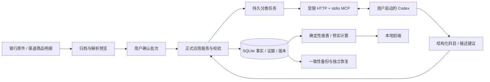

# v0.5 技术方案与开发分工

日期：2026-10-29，Asia/Shanghai。用户已指示按新规格开工，本文件将候选需求落实为开发基线；业务范围见主规格及闭环规格。首个集成里程碑为R00/R01/R02，后续R03—R10按既定依赖增量交付；不重做历史迁移。本文件持续记录接口决定和验收状态，不能把开发中写成已交付。

## 1. 架构与责任

保留FastAPI单应用、SQLite单写入口、React/Vite和原有UI组件。新增业务模块对外提供initialize(db)、register_routes(app,store)及纯服务函数；所有写操作复用Store事务、operation幂等、save_transaction审计和advance财务修订。只有主代理修改app/main.py、app/storage.py、app/security.py及跨模块前端入口，避免多人同时改路由/迁移。

- `app/coverage.py`：账户/期间覆盖声明与版本，指标明确已知金额和完整性。既有历史保持partial，不替用户确认完整。
- `app/imports_v2.py`及`app/import_parsers/`：文件归档、解析预览、来源namespace、批次和逐行处理状态，复用既有源记录/交易/原件表；原生格式逐一登记，不根据扩展名猜。
- `app/ai_work.py`：持久分类问题、稳定issue_key/代次、租约、上下文、字段白名单、提交和回执；只开放已确认消费的科目/客观描述。
- `app/finance_mcp.py`/`scripts/run_finance_mcp.py`：Python官方MCP SDK stdio薄适配，HTTP调用受限AI路由，不打开SQLite，不持用户Cookie。
- `app/maintenance.py`/`scripts/restore_backup.py`：一致性备份、附件哈希、独立恢复，不直接覆盖在线目录。
- 已有`domain/reports/budget/historical`：修复金额/期间不变量并保持历史解释兼容；不在模型中重新实现计算。

共享服务逐步提取而非一轮重构全部路由。模型任务不持SQLite事务；文件解析也在写事务外。任务状态与财务data_revision分开；投影以现有提交钩子保证一致，先量测再决定增量化。

## 2. 数据与迁移合同

schema2增量升schema3；接受1/2/3，迁移前SQLite一致性备份，建新表不改原交易/预算。新模块initialize使用逐条DDL，不使用破坏外层事务的executescript；所有初始化在Store单个迁移事务内完成。生产库在隔离副本验收和完整备份前不迁移。

来源身份为source_namespace+account_id+source_id；旧source_identity不直接删除，既有身份归legacy或standard_csv_v1命名空间。新解析观察关联旧经济事实，不以parser版本新造交易；不同局部ID的还款证据不得各自推导完整双端效果。

首版原生资金流水仅产生可证实本端效果；未知关系不推造对端。普通信用还款不能任意绑定payment预算；支持的历史事项保留原解释，新增付款预算例外须有独立证据和金额约束。

AI表：work_items（issue_key/generation/target_version/evidence与规则依赖/status/attempt）、work_leases或同表令牌/时限、proposals及processing_runs。事务提交返回实际应用结果，写入actor固定为ai；不接受模型传actor、人类锁或金额/账户/日期/性质/关系/预算字段。

## 3. 接口约定

所有金额为整数分十进制字符串，JSON错误遵循现有DomainError。财务事实、覆盖声明、任务及批次命令含request_id和相应expected_version；只产生独立副本的备份/恢复操作不修改财务事实。不使用模型confidence授予权限。

| 路由族 | 用途 | 身份 |
|---|---|---|
| `/api/v1/import-batches` | 上传并预览、查询列表/详情、应用确认批次、取消/续做 | 本机浏览器 |
| `/api/v1/coverage` | 按账户/月查看和保存带证据的覆盖声明 | 本机浏览器 |
| `/api/v1/ai/work-items`、`/api/v1/ai/prepare` | 查看持久队列、准备指定批次/未分类消费；返回可复制指令 | 本机浏览器 |
| `/api/ai/v1/...` | list/claim/context/submit/result受限工具对应接口 | 独立Bearer能力令牌；浏览器Cookie不授予机器权限 |
| `/api/v1/maintenance/...` | 创建/列备份、下载及恢复校验结果 | 本机浏览器，MCP无权 |
| `/api/v1/operations/{request_id}` | 用户超时回查 | 原有身份；MCP只可查询自己的操作结果 |

新路由注册必须在main.py通配404和StaticFiles挂载之前。模块用app.state.store或显式store，不创建第二个生产Store。已有标准CSV路径保留兼容，新增预览入口为默认用户路径；其历史符号政策不改变。

## 4. 处理与失败合同

上传归档→解析预览→确认应用→规则确定消费/其他性质→待分类消费入总额→用户准备Codex批次→真实领取→语义建议→同事务校验/应用/回执→页面查结果。文件行、有效业务和待办计数分别返回，不相加。

预览/未知格式失败不推进财务修订。应用按完整业务组提交；重试仅做未处理行；取消不会回滚此前成功项或留下半笔。原始文件和来源行不可覆盖；解析修订提示冲突，不抢人工修改。

AI只修改当代目标版本允许字段；目标已有人工分类/描述覆盖则不替换。上下文只给授权证据ID和必要字段，不返回完整账号/任意文件。提交校验issue代次、租约、目标、证据/规则；幂等回执先于过期检查，首次过期请求拒绝。领取/心跳不advance；确有事实改变才advance。

## 5. 权限与本机执行边界

机器令牌只能访问`/api/ai/v1`且不能使用浏览器用户接口，不能借普通session入口升级。原生MCP服务仅HTTP客户端，不暴露shell、SQL或磁盘路径。模型响应中的原始文件文字均作为证据数据。

接口隔离不等于整个本机Codex进程隔离。协议和真实Codex联调使用隔离合成库；未验证专用执行环境权限前不宣称真实账本自动处理已全部放行。首期不引入一键Runner或后台唤醒。生产可显示待处理/连接指导，能力开关以实测为准。

## 6. 并行分工与文件所有权

| 开发单元 | 独占文件范围 | 交付 |
|---|---|---|
| 账务正确性代理 | domain.py/reports.py/budget.py、coverage.py、对应新测试 | FIX-01/02/03/04纯业务边界、期间质量、未分配占用；向主代理给main校验接线要求 |
| 导入代理 | imports_v2.py、import_parsers/、对应新测试与合成fixtures | 一种真实可证格式+预览/应用/重导/失败/批次查询；不改共享入口 |
| AI/MCP代理 | ai_work.py、finance_mcp.py、MCP启动脚本、对应新测试/评测 | 持久任务/租约/受控分类、stdio协议与最小工具；给出依赖变更 |
| 主代理 | main/storage/security、maintenance及restore、前端接线、技术文档 | 集成schema3、权限、备份恢复、批次/AI/覆盖UI和全面验收 |

后续可把独立验收、前端和R03/R05交给已完成的代理，仍按文件所有权避免覆盖。每位代理禁止写生产data/app、改用户采用预算、重跑私人加工或提交真实演示交易。

## 7. 验收和发布

先保存当前实现基线与完整数据备份。每模块使用pytest临时库验证关键负例，根代理运行所有应用测试/构建和生产构建浏览器路径。独立验收覆盖AC58—69基础分支、AC75恢复和AC78当前规模，中间读任务不使报告过期。

真实源格式只读验证解析与原件哈希，不把识别结果直接导入生产；历史兼容影子库核对前后收入/费用/现金/预算，发现差异列原因，不为贴旧值保留错误。通过后方可重启本机应用及增量迁移；完整备份和恢复演练记录在交付记录。新的AI类别精确率、连接/执行环境和未完成分支如实披露。

R03预算草稿/采用、R04多源/对账、R05/R06分析、R07计划、R08导出、R09投资、R10维护按实施计划继续；本文件不把首批开发称为完整v0.5完成。

## 8. 首批验收结论（2026-10-30）

R00 与限定来源的 R01 已部署到本机；R02 的持久任务、stdio 服务、API 校验和真实 Codex 合成流程通过，但生产机器写入未启用。新服务已迁移至 schema 3，真实财务修订保持 2，六类事实/来源表保持原值；Excel 15,796 项核对零差异。最终全套 428 项测试、四套合成浏览器流程与正式服务只读检查通过，证据详见[开发记录](implementation-status.md)。

独立验收实际拦截并修复了并发请求多处理、旧同号配对、上下文截断遗漏新增证据和恢复目标覆盖等问题。技术实现不是依靠测试数量放行：真实 Codex 仍可见非 MCP 文件工具，因此 AC-64 执行隔离未通过；120 条金标虽已准备，尚无模型精确率结果。两项均是后续真实机器写入的明确门槛，不以用户再次确认代替技术验证。

后续开发优先级：完成 R02 的专用执行边界及语义评测；并行推进 R03 预算草稿/采用与规则治理、R05 同窗报销标准化预实。R04 先补关系/重复候选的人工处置命令，再逐一扩展银行格式，不重新导入或静默改写已迁移历史。R06 分析引用正式、版本化计算结果；R07—R10 保留已列范围。
